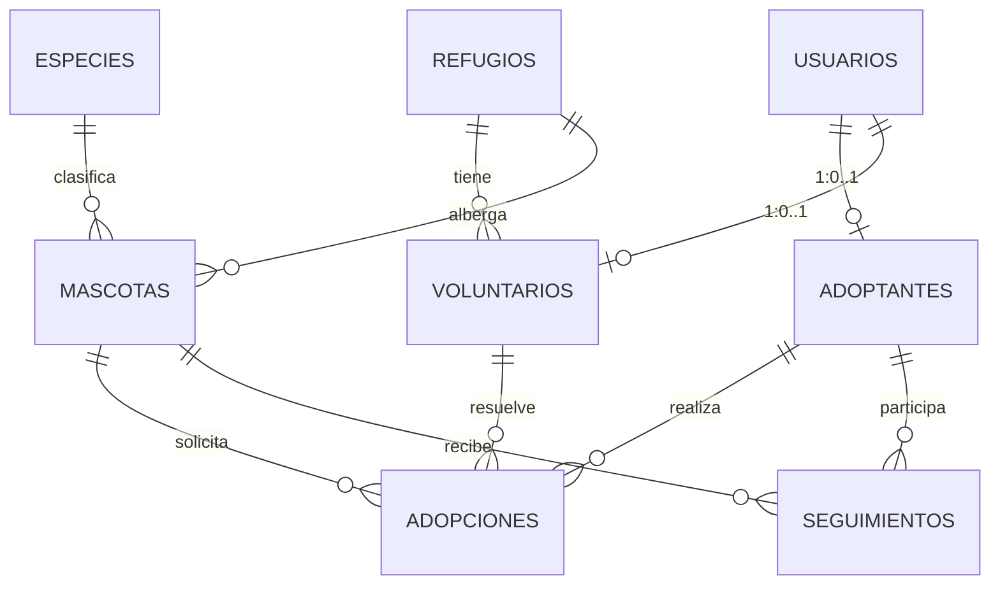

# Informe técnico — Huellas de Amor

Proyecto final de Frameworks. Aplicación full stack para adopción responsable de mascotas en Villavicencio (Meta, Colombia).

## 1. Contexto del problema (B1)

### Actores
- **Adoptantes**: personas que buscan un compañero animal.
- **Voluntarios**: acompañan solicitudes, inventario y seguimiento postadopción.
- **Administradores**: autogestionan el sistema (métricas, CRUD, KPIs).
- **Refugios**: puntos de acogida físicos aliados.

### Problema
La adopción local suele fragmentarse en chats y hojas de cálculo: no hay un flujo único para descubrir mascotas, solicitar adopción con trazabilidad y hacer seguimiento. Eso genera desconfianza, pérdida de solicitudes y poca visibilidad del estado de cada animal.

### Justificación full stack
Se necesita **backend** (seguridad por roles, persistencia, reglas de negocio) y **frontend** (catálogo público, formularios, paneles) en una sola aplicación desplegable. Spring Boot + Thymeleaf + Spring Security resuelven el problema sin separar front/back innecesariamente para el alcance académico y operativo.

### Alcance y objetivos
- Catálogo público con detalle (edad, raza, salud, refugio).
- Registro/login con validaciones y roles.
- Solicitudes de adopción y resolución por voluntario/admin.
- Seguimiento postadopción.
- Panel administrativo con métricas.

Fuera de alcance: pagos, app móvil nativa, marketplace de insumos.

## 2. Requerimientos (B2)

### Funcionales
| ID | Requerimiento | Módulo |
|----|---------------|--------|
| RF01 | Ver catálogo y filtrar mascotas disponibles | Mascotas |
| RF02 | Ver detalle de mascota sin cuenta | Mascotas |
| RF03 | Registrarse como adoptante | Auth |
| RF04 | Iniciar/cerrar sesión con roles | Auth / Security |
| RF05 | Solicitar adopción (adoptante) | Adopciones |
| RF06 | Aprobar/rechazar solicitudes | Adopciones |
| RF07 | CRUD mascotas y refugios | Admin / Voluntario |
| RF08 | Registrar seguimientos postadopción | Seguimientos |
| RF09 | Panel admin con KPIs y pestañas | Admin |
| RF10 | Panel voluntario orientado a su rol | Voluntario |
| RF11 | Landing con refugios, mapa y guía | Público |
| RF12 | Términos y privacidad | Legal |

### No funcionales
| ID | Requerimiento |
|----|---------------|
| RNF01 | Roles ADMIN, VOLUNTARIO, ADOPTANTE con Spring Security |
| RNF02 | Contraseñas con BCrypt |
| RNF03 | Validación de registro (correo real, fortaleza, ofensivos) |
| RNF04 | Rate limit en POST `/login` |
| RNF05 | Cabeceras XSS/CSP |
| RNF06 | Despliegue en Render + PostgreSQL (Neon) |
| RNF07 | UI responsive (móvil / laptop) |

### Roles
- **ADMIN**: administración completa.
- **VOLUNTARIO**: inventario, solicitudes y seguimientos.
- **ADOPTANTE**: catálogo, solicitud e historial.
- **Anónimo**: inicio, catálogo, detalle, refugios, registro/login.

## 3. Modelo relacional (B3)

### Diccionario (resumen)
| Tabla | PK | FK / notas |
|-------|----|------------|
| usuarios | id | rol ENUM, password BCrypt |
| adoptantes | id | id_usuario → usuarios |
| voluntarios | id | id_usuario → usuarios, id_refugio → refugios |
| refugios | id | contacto, dirección |
| especies | id | Perro / Gato |
| mascotas | id | id_especie, id_refugio, estado |
| adopciones | id | id_mascota, id_adoptante, id_voluntario?, estado |
| seguimientos_post_adopcion | id | id_mascota, id_adoptante |

Normalización: 3FN (atributos atómicos, sin grupos repetitivos; relaciones N:1 hacia especies/refugios).

## 4. Endpoints / rutas MVC (B4)

La app es **MVC Thymeleaf** (vistas HTML), no API REST pura. Equivalente de “endpoints”:

| Método | Ruta | Parámetros / cuerpo | Respuesta | Roles |
|--------|------|---------------------|-----------|-------|
| GET | `/` | — | Vista inicio 200 | Público |
| GET | `/login` | — | Vista login 200; si autenticado → 302 `/redirigir` | Público |
| POST | `/login` | username, password (+ CSRF) | 302 panel según rol / `?error` | Público |
| GET/POST | `/registro` | DTO adoptante | Form / 302 login | Público |
| GET | `/mascotas/catalogo` | filtros query | Catálogo 200 | Público |
| GET | `/mascotas/detalle/{id}` | id | Detalle 200 / 404 | Público |
| GET | `/refugios` | — | Lista 200 | Público |
| GET | `/admin` | tab | Panel admin 200 | ADMIN |
| GET | `/voluntario` | tab | Panel voluntario 200 | VOLUNTARIO, ADMIN |
| GET | `/adoptante` | — | Panel adoptante 200 | ADOPTANTE, ADMIN |
| POST | `/adopciones/solicitar/{id}` | observaciones | 302 | ADOPTANTE |
| GET | `/adopciones/gestionar` | — | Tabla 200 | VOLUNTARIO, ADMIN |
| POST | `/adopciones/gestionar/{id}/aprobar\|rechazar` | observaciones | 302 | VOLUNTARIO, ADMIN |
| CRUD | `/mascotas/gestionar/**` | DTO | Formularios / redirects | VOLUNTARIO, ADMIN |
| CRUD | `/refugios/**` (escritura) | DTO | Formularios / redirects | VOLUNTARIO, ADMIN |
| GET/POST | `/seguimientos/**` | DTO | Lista / form | VOLUNTARIO, ADMIN |
| GET | `/terminos`, `/privacidad`, `/como-adoptar` | — | Vistas legales 200 | Público |

Pruebas sugeridas: login con los 3 roles demo, filtro de catálogo, solicitud de adopción, aprobación en panel.

## 5. Vistas (B5)

| Vista | Propósito | Flujo |
|-------|-----------|-------|
| `index` | Landing + destacados + mapa | → catálogo / registro |
| `mascotas/catalogo` | Explorar y filtrar | → detalle |
| `mascotas/detalle` | Info completa + CTA adoptar | → login/registro o solicitud |
| `login` / `registro` | Auth | → `/redirigir` o guía |
| `admin/panel` | KPIs + pestañas de gestión | → CRUD / adopciones |
| `voluntario/panel` | Solicitudes, mascotas, seguimientos | → aprobar / CRUD |
| `adoptante/panel` | Disponibles + historial | → detalle / solicitud |
| `refugios/lista` | Puntos de acogida | público / edición autenticada |
| `como-adoptar`, `legal/*` | Confianza y cumplimiento | enlaces footer |

## 6. Justificación tecnológica (A1–A3)

| Tecnología vista | ¿Usada? | Motivo |
|------------------|--------|--------|
| Spring Boot | Sí | Backend, JPA, despliegue |
| Thymeleaf | Sí | Vistas server-side integradas al monolito |
| Spring Security | Sí | Roles, login, CSRF, cabeceras |
| SerpAPI / React / Strapi / Next.js | No | Añadirían complejidad innecesaria al alcance (un solo deploy Render + Postgres) |

Integración (A3): un solo artefacto JAR/Docker, seed de datos, Neon/Render y navegación coherente entre módulos públicos y protegidos.
